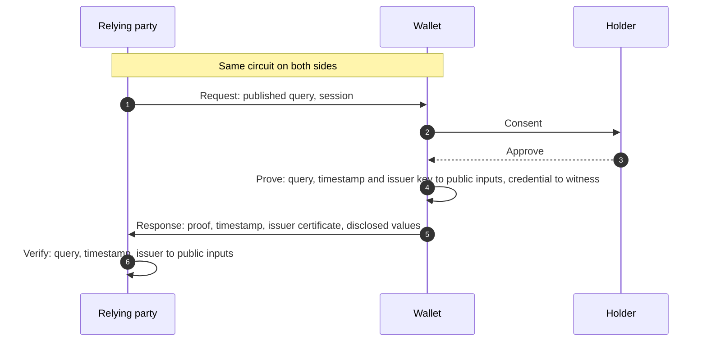

# Predicate circuit: provisional design

Every Longfellow implementation in use today comprises one set of circuits. This set of circuits varies on the 
number of attributes supported, and each circuit demonstrates only equality per attribute. Beyond this equality 
computation, the existing circuits check, among other things, the issuer signature over the MSO, the validity 
window and the device key.

This proposal replaces the 'equality only' circuit family with a circuit that encodes a number of 'predicates'. A 
predicate is a combination of an attribute and an opcode.
Opcodes can take a supplied value. Opcodes could include equality, less-or-equal, disclosure, or a pseudonym. Other 
opcodes could exist. A 'query' is a list of predicates, including opcodes, attributes, and operands. A 'proof' shows that the holder's credential satisfies every
predicate in the query.

A sufficiently 'useful' circuit can be derived from an answer to the questions "How many types of queries do 
users of the circuit possibly need to ask?" and "What is the largest number of attributes that a querying party  
possibly needs in their most complex query?". The answers to these questions are *constraints* on the
use of the circuit, and by constraining the behaviour of this 'useful' circuit in advance, we make circuit verification 
a tractable problem. 

The ARF lists per-use-case circuits as a disadvantage of circuit-based zero-knowledge proofs. One
fixed circuit is the answer to that.

The bulk of any circuit's wires is spent, as a fixed cost, in:

- the SHA-256 over the MSO (~2,190,000 wires)
- the issuer's signature over that hash and the device's signature over the session transcript (~167,000 wires)
- the document type, the validity window and the device key, read out of the MSO (~129,000 wires)

This totals ~2,490,000 wires.

In addition to this, any predicate requires:

- the SHA-256 over an attribute (~107,000 wires)
- the attribute's digest, located in the MSO (~31,000 wires)
- the attribute's identifier and value, parsed and compared against the public inputs (~20,000 wires)
- an opcode selector (~50 wires for three opcodes)
- one gadget per opcode (~1,400 wires for a 20-byte lte, for example)

This totals ~159,000 wires (about 6 percent of the fixed overhead of the circuit in the lte case)

The cost of any given predicate is a marginal addition to the overall circuit cost
(given reasonable opcode gadgets).

Wire counts are from the version 8 circuit at `google/longfellow-zk` 61a8a73, compiled with upstream's compiler.


## The circuit

A circuit is compiled once, from source that can be read and audited, and shipped as one fixed
artifact together with its harness and manifest.

The 'harness' is the code that maps a query onto the public inputs, builds the witness from the credential, 
and runs prove or verify.

The 'manifest' is a list of circuit components. It names the building blocks that make up the circuit, the 
opcodes those blocks provide, the operand types, the predicate count, the public-input layout, the provenance of the
circuit, and the circuit hash.

A manifest for the current one-attribute circuit in google/longfellow-zk, version 8 at commit
61a8a73, might look like this:


```json
{
  "circuit": "mdoc-attribute/8/1-attribute",
  "hash": "...",
  "source": {
    "repository": "https://github.com/google/longfellow-zk",
    "commit": "61a8a73",
    "version": 8
  },
  "proof_system": {
    "name": "longfellow-libzk-v1",
    "specification": "draft-google-cfrg-libzk-02",
    "fields": {"signature_circuit": "p256", "hash_circuit": "gf2_128"}
  },
  "gadgets": [
    {"id": "ecdsa-p256", "field": "p256", "path": "rust/circuits/ecdsa2"},
    {"id": "mac-gf2-128-in-p256", "field": "p256", "path": "rust/circuits/mac"},
    {"id": "sha256", "field": "gf2_128", "path": "rust/circuits/sha256msg"},
    {"id": "memcmp", "field": "gf2_128", "path": "rust/circuits/memcmp"},
    {"id": "cbor-decoder", "field": "gf2_128", "path": "rust/applications/mdoc_zk/circuits/src/cbor_decoder"},
    {"id": "mac-gf2-128", "field": "gf2_128", "path": "rust/circuits/mac_gf128"},
    {"id": "mso", "field": "gf2_128", "path": "rust/applications/mdoc_zk/circuits/src/hash"},
    {"id": "item", "field": "gf2_128", "path": "rust/applications/mdoc_zk/circuits/src/mso_attribute"}
  ],
  "opcodes": [
    {"id": "eq", "gadgets": ["item"], "operand": {"type": "bytes", "max_bytes": 64, "encodings": ["cbor"]}}
  ],
  "limits": {
    "max_mso_sha256_blocks": 40,
    "max_item_bytes": 128,
    "identifier_bytes": 32,
    "value_bytes": 64,
    "now_bytes": 20
  },
  "public_inputs": [
    {"name": "expected_doc_type", "type": "bytes", "max_bytes": 32, "used_by": ["mso"]},
    {"name": "suppress_doc_type_check", "type": "bool", "used_by": ["mso"]},
    {"name": "now", "type": "bytes", "bytes": 20, "used_by": ["mso", "memcmp"]},
    {"name": "issuer_key", "type": "field", "count": 2, "used_by": ["ecdsa-p256"]},
    {"name": "session_transcript_hash", "type": "bytes", "bytes": 32, "used_by": ["ecdsa-p256"]},
    {"name": "mac_challenge", "type": "field", "used_by": ["mac-gf2-128", "mac-gf2-128-in-p256"]},
    {"name": "mac_tags", "type": "field", "count": 6, "used_by": ["mac-gf2-128", "mac-gf2-128-in-p256"]}
  ],
  "private_inputs": [
    {"name": "issuer_sig_structure", "type": "bytes", "max_bytes": 2560, "used_by": ["sha256", "mso"]},
    {"name": "doc_type_offset", "type": "uint", "bits": 16, "used_by": ["mso"]},
    {"name": "valid_from_offset", "type": "uint", "bits": 16, "used_by": ["mso"]},
    {"name": "valid_until_offset", "type": "uint", "bits": 16, "used_by": ["mso"]},
    {"name": "device_key_info_offset", "type": "uint", "bits": 16, "used_by": ["mso"]},
    {"name": "value_digests_offset", "type": "uint", "bits": 16, "used_by": ["mso"]},
    {"name": "issuer_sig_e", "type": "bytes", "bytes": 32, "used_by": ["sha256", "ecdsa-p256", "mac-gf2-128", "mac-gf2-128-in-p256"]},
    {"name": "device_pk", "type": "bytes", "bytes": 64, "used_by": ["mso", "ecdsa-p256", "mac-gf2-128", "mac-gf2-128-in-p256"]},
    {"name": "issuer_signature", "type": "field", "count": 2, "used_by": ["ecdsa-p256"]},
    {"name": "device_signature", "type": "field", "count": 2, "used_by": ["ecdsa-p256"]},
    {"name": "mac_key_shares", "type": "field", "count": 6, "used_by": ["mac-gf2-128", "mac-gf2-128-in-p256"]}
  ],
  "predicates": [
    {
      "opcodes": ["eq"],
      "public_inputs": [
        {"name": "identifier", "type": "bytes", "max_bytes": 32, "encodings": ["cbor"], "used_by": ["item"]},
        {"name": "operand", "type": "bytes", "max_bytes": 64, "encodings": ["cbor"], "used_by": ["item"]}
      ],
      "private_inputs": [
        {"name": "item_bytes", "type": "bytes", "max_bytes": 128, "used_by": ["sha256", "cbor-decoder", "item"]},
        {"name": "item_field_offsets", "type": "uint", "bits": 10, "used_by": ["cbor-decoder", "item"]},
        {"name": "item_digest_offset", "type": "uint", "bits": 16, "used_by": ["mso"]}
      ]
    }
  ]
}
```

The circuit grows by adding predicates, gadgets, and opcodes for those gadgets. The below example replaces the single
equality predicate above with two predicates, one supporting equality and 'less than or equal to', and one supporting 
equality and set membership:

```json
{
  "circuit": "...",
  "hash": "...",
  "source": "...",
  "proof_system": "...",
  "gadgets": [
    {"id": "ecdsa-p256", "field": "p256", "path": "rust/circuits/ecdsa2"},
    {"id": "mac-gf2-128-in-p256", "field": "p256", "path": "rust/circuits/mac"},
    {"id": "sha256", "field": "gf2_128", "path": "rust/circuits/sha256msg"},
    {"id": "memcmp", "field": "gf2_128", "path": "rust/circuits/memcmp"},
    {"id": "cbor-decoder", "field": "gf2_128", "path": "rust/applications/mdoc_zk/circuits/src/cbor_decoder"},
    {"id": "mac-gf2-128", "field": "gf2_128", "path": "rust/circuits/mac_gf128"},
    {"id": "mso", "field": "gf2_128", "path": "rust/applications/mdoc_zk/circuits/src/hash"},
    {"id": "item", "field": "gf2_128", "path": "rust/applications/mdoc_zk/circuits/src/mso_attribute"},
    {"id": "member", "field": "gf2_128"}
  ],
  "opcodes": [
    {"id": "eq", "gadgets": ["item"], "operand": {"type": "bytes", "max_bytes": 64, "encodings": ["cbor"]}},
    {"id": "lte", "gadgets": ["memcmp"], "operand": {"type": "bytes", "max_bytes": 64, "encodings": ["cbor"]}},
    {"id": "member", "gadgets": ["member"], "operand": {"type": "bytes", "max_bytes": 64, "count": 32, "encodings": ["cbor"]}}
  ],
  "limits": "...",
  "public_inputs": "...",
  "private_inputs": "...",
  "predicates": [
    {
      "opcodes": ["eq", "lte"],
      "public_inputs": [
        {"name": "identifier", "type": "bytes", "max_bytes": 32, "encodings": ["cbor"], "used_by": ["item"]},
        {"name": "opcode", "type": "uint", "bits": 8, "used_by": ["item", "memcmp"]},
        {"name": "operand", "type": "bytes", "max_bytes": 64, "encodings": ["cbor"], "used_by": ["item", "memcmp"]}
      ],
      "private_inputs": [
        {"name": "item_bytes", "type": "bytes", "max_bytes": 128, "used_by": ["sha256", "cbor-decoder", "item"]},
        {"name": "item_field_offsets", "type": "uint", "bits": 10, "used_by": ["cbor-decoder", "item"]},
        {"name": "item_digest_offset", "type": "uint", "bits": 16, "used_by": ["mso"]}
      ]
    },
    {
      "opcodes": ["eq", "member"],
      "public_inputs": [
        {"name": "identifier", "type": "bytes", "max_bytes": 32, "encodings": ["cbor"], "used_by": ["item"]},
        {"name": "opcode", "type": "uint", "bits": 8, "used_by": ["item", "member"]},
        {"name": "operand", "type": "bytes", "max_bytes": 64, "count": 32, "encodings": ["cbor"], "used_by": ["item", "member"]},
        {"name": "operand_count", "type": "uint", "bits": 6, "used_by": ["member"]}
      ],
      "private_inputs": [
        {"name": "item_bytes", "type": "bytes", "max_bytes": 128, "used_by": ["sha256", "cbor-decoder", "item"]},
        {"name": "item_field_offsets", "type": "uint", "bits": 10, "used_by": ["cbor-decoder", "item"]},
        {"name": "item_digest_offset", "type": "uint", "bits": 16, "used_by": ["mso"]}
      ]
    }
  ]
}
```


## Published queries

A query specifies a circuit, a document type, and predicates with their operands. It can be fixed in
advance and published. Since relying parties must register, declaring what they may want to ask,
the registrar of relying parties can maintain the 'canonical' list of queries, keyed by relying party.
As this list is public, anyone can then audit what a given relying party may ask.
TS5 specifies that list at the level of claim paths, without values. ARF Topic 44 specifies the
registration certificate a relying party carries in its request.

A published query is a DCQL credential query, published by the registrar and identified by the
hash of its bytes. Each claim gains an `op` and `operand` field. A published query could look like this:

```json
{
  "id": "pid",
  "format": "mso_mdoc_zk",
  "meta": {
    "doctype_value": "eu.europa.ec.eudi.pid.1",
    "zk_system_type": [
      {"system": "longfellow-libzk-v1", "id": "...", "version": 8,
           "circuit_hash": "...", "num_attributes": 2,
           "block_enc_hash": 5246, "block_enc_sig": 4445}
    ]
  },
  "claims": [
    {"path": ["eu.europa.ec.eudi.pid.1", "age_over_18"],
     "op": "eq", "operand": {"type": "bool", "value": true}},
    {"path": ["eu.europa.ec.eudi.pid.1", "resident_country"],
     "op": "member", "operand": {"type": "text", "values": ["AT", "BE", "DE"]}}
  ]
}
```

## The exchange

The exchange is OpenID4VP 1.0. The DCQL credential query and the vp_token use Multipaz's
`mso_mdoc_zk` format, deployed, with openid/OpenID4VP#627 open. The request
and response below are those.

A circuit is distributed to both prover and verifier with its manifest and harness. Both prover and verifier agree on
what circuit (and harness) version to use before any query takes place.
This could happen via a handshake, or by the query naming a
release and the wallet refusing any other. Both sides update on their own cycles and may hold
more than one release during a transition. The answer to a query is a proof. The diagram shows
one presentation on the happy path; the checks are in the steps.



### 1. Request, relying party to wallet

This design adds `published_query` to the credential query's `meta`. The request omits
`claims`, since the wallet reads them from the published query.

```json
{
  "client_id": "x509_san_dns:verifier.example.org",
  "response_type": "vp_token",
  "response_mode": "direct_post",
  "response_uri": "https://verifier.example.org/response",
  "nonce": "n-0S6_WzA2Mj",
  "dcql_query": {
    "credentials": [{
      "id": "pid",
      "format": "mso_mdoc_zk",
      "meta": {
        "doctype_value": "eu.europa.ec.eudi.pid.1",
        "zk_system_type": [
          {"system": "longfellow-libzk-v1", "id": "...", "version": 8,
           "circuit_hash": "...", "num_attributes": 2,
           "block_enc_hash": 5246, "block_enc_sig": 4445}
        ],
        "published_query": "..."
      }
    }]
  }
}
```


### 2. Wallet

1. Checks that it has the circuit, and that the relying party is registered for the query;
   refuses otherwise.
2. Renders the published query for consent.
3. Expands the published query, its own timestamp and the credential's issuer key onto the
   public inputs with the release's harness.
4. Builds the witness from the credential: MSO bytes and offsets, the IssuerSignedItem for each
   predicate, the device signature over the session transcript.
5. Proves.

### 3. Response, wallet to relying party

The response is unchanged from what Multipaz sends today.

```text
vp_token = {"pid": ["<base64url DeviceResponse>"]}

DeviceResponse {
  version: "1.0",
  zkDocuments: [{
    proof: <bstr>,                          // signature circuit proof + hash circuit proof
    documentData: 24(<bstr> {               // ZkDocumentData
      zkSystemId: "longfellow-libzk-v1_<version>_<attributes>_<block_enc_hash>_<block_enc_sig>_<circuit_hash>",
      docType: "eu.europa.ec.eudi.pid.1",
      timestamp: 0("2026-09-09T12:00:00Z"),  // the wallet's now, a public input
      issuerSigned: {},                      // disclosed values; none in this query
      deviceSigned: {},
      msoX5chain: <issuer certificate>       // the issuer key, a public input
    })
  }],
  status: 0
}
```

### 4. Verifier

1. Checks the circuit id; rejects otherwise.
2. Expands its own copy of the published query onto the public inputs. It takes the timestamp,
   the issuer key and disclosed values from the response and everything else
   from its own copy.
3. Checks the timestamp and the issuer certificate.
4. Verifies.

## Open questions

- How should a given gadget (or circuit-as-composition-of-gadgets) be validated as 'sound' or 'acceptable'?
- How should a given circuit's harness be validated as 'sound' or 'acceptable'?
- Which opcodes and how many predicates, and what data types or limits comprise a 'useful' or 'good enough' circuit?
- Who publishes the query list, and how does it attach to relying-party registration?
- Who decides the consent text: the published query, or the wallet?
- Which pseudonym construction is to be used?
- What does the wallet do when it is offline and does not have the published query?

## References

- google/longfellow-zk, version 8 circuit crate:
  https://github.com/google/longfellow-zk/blob/61a8a73/rust/applications/mdoc_zk/circuits/src/lib.rs
- google/longfellow-zk, version 8 attribute circuit, element identifier and value binding:
  https://github.com/google/longfellow-zk/blob/61a8a73/rust/applications/mdoc_zk/circuits/src/mso_attribute/circuit.rs
- google/longfellow-zk, version 8 circuit table, `CURRENT_ZK_SPECS`:
  https://github.com/google/longfellow-zk/blob/61a8a73/rust/applications/mdoc_zk/runtime/src/zk_spec.rs
- draft-google-cfrg-libzk-02: https://www.ietf.org/archive/id/draft-google-cfrg-libzk-02.html
- ISRG zk-cred-longfellow, mdoc circuit interface notes, commit 59709c4:
  https://github.com/abetterinternet/zk-cred-longfellow/blob/59709c4/src/mdoc_zk/circuit_interface.md
- EU age-verification iOS library on Longfellow, commit c51bdfd:
  https://github.com/eu-digital-identity-wallet/av-lib-ios-longfellow-zkp/blob/c51bdfd/README.md
- Dyne distribution of Longfellow-ZK, commit d2b0fc5:
  https://github.com/dyne/longfellow-zk/blob/d2b0fc5/README.md
- Multipaz, `multipaz-longfellow` bundles Google Longfellow-ZK, commit 9faa41a1:
  https://github.com/openwallet-foundation/multipaz/blob/9faa41a1/README.md
- EUDI Android wallet-core, Multipaz longfellow dependency, commit 6533dd10:
  https://github.com/eu-digital-identity-wallet/eudi-lib-android-wallet-core/blob/6533dd10/gradle/libs.versions.toml
- OpenID for Verifiable Presentations 1.0, with the Digital Credentials Query Language:
  https://openid.net/specs/openid-4-verifiable-presentations-1_0.html
- Commission Implementing Regulation (EU) 2025/848, relying-party registration, registration certificates optional:
  https://eur-lex.europa.eu/eli/reg_impl/2025/848/oj
- openid/OpenID4VP issue 627, support for mdoc ZKP requests:
  https://github.com/openid/OpenID4VP/issues/627
- Multipaz, Longfellow ZK system, `zk_system_type` entry parameters, commit e4b1d438:
  https://github.com/openwallet-foundation/multipaz/blob/e4b1d438/multipaz-longfellow/src/commonMain/kotlin/org/multipaz/mdoc/zkp/longfellow/LongfellowZkSystem.kt
- Multipaz, `ZkDocumentData` response fields, commit e4b1d438:
  https://github.com/openwallet-foundation/multipaz/blob/e4b1d438/multipaz/src/commonMain/kotlin/org/multipaz/mdoc/zkp/ZkDocumentData.kt
- EUDI ARF, discussion topic G, zero-knowledge proofs, section 3.2.3, commit 5cdf797f:
  https://github.com/eu-digital-identity-wallet/eudi-doc-architecture-and-reference-framework/blob/5cdf797f/docs/discussion-topics/g-zero-knowledge-proof.md
- EUDI ARF, discussion topic 44, relying-party registration and registration certificates, commit 2534ab77:
  https://github.com/eu-digital-identity-wallet/eudi-doc-architecture-and-reference-framework/blob/2534ab77/docs/discussion-topics/x-relying-party-registration.md
- EUDI TS5, common formats and API for relying-party registration information, commit fce24dbb:
  https://github.com/eu-digital-identity-wallet/eudi-doc-standards-and-technical-specifications/blob/fce24dbb/docs/technical-specifications/ts5-common-formats-and-api-for-rp-registration-information.md
